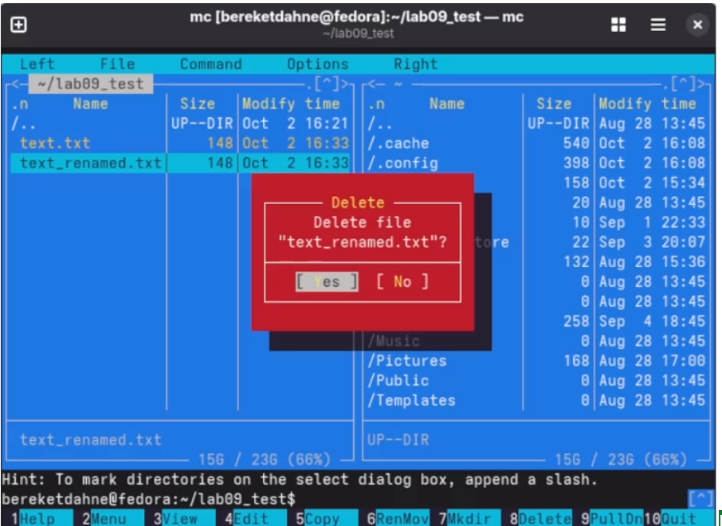

---
title: "Лабораторная работа № 9"
author: "Bereket Dagne"
date: "2026-10-02"
lang: ru
mainfont: "DejaVu Serif"
monofont: "DejaVu Sans Mono"
pdf-engine: xelatex
---

# Лабораторная работа № 9
## Командная оболочка Midnight Commander

---

### Цель работы
Освоение основных возможностей командной оболочки Midnight Commander. Приобретение навыков практической работы по просмотру каталогов и файлов; манипуляций с ними.

---

### Выполнение работы

#### 1. Запуск Midnight Commander
```bash
mc
```

#### 2. Работа с панелями
- Переключение между панелями: `Tab`
- Открытие меню: `F9`
- Создание каталога: `F7`
- Создание файла: `Shift + F4`
- Редактирование файла: `F4`
- Копирование файла: `F5`
- Переименование/перемещение: `F6`
- Удаление файла: `F8`
- Выход: `F10`

#### 3. Создание каталога и файла
Создан каталог `lab09_test` и файл `text.txt`.

#### 4. Редактирование файла
Файл `text.txt` отредактирован во встроенном редакторе mc.

#### 5. Файловые операции
- Копирование файла: `text_copy.txt`
- Переименование: `text_renamed.txt`
- Удаление: `text_renamed.txt`

#### 6. Работа с меню
- Меню Файл (F9)
- Меню Команда (F9)
- Меню Настройки (F9)

#### 7. Встроенный редактор
- Поиск текста (F7)
- Сохранение (F2)
- Выход (F10)

---

### Результаты работы

**Скриншот 1:** Главное окно Midnight Commander

{ width=6in }

\newpage

**Скриншот 2:** Копирование файла

{ width=6in }

\newpage

**Скриншот 3:** Перемещение/переименование файла

{ width=6in }

\newpage

**Скриншот 4:** Удаление файла

{ width=6in }

\newpage

**Скриншот 5:** Встроенный редактор

{ width=6in }


---

### Ответы на контрольные вопросы

**1. Какие режимы работы есть в mc? Охарактеризуйте их.**
- **Панельный режим** — основной режим с двумя панелями
- **Режим Информация** — показывает сведения о файле и файловой системе
- **Режим Дерево** — показывает структуру каталогов
- **Встроенный редактор** — для редактирования текстовых файлов
- **Встроенный просмотрщик** — для просмотра файлов

**2. Какие операции с файлами можно выполнить как с помощью команд shell, так и с помощью меню (комбинаций клавиш) mc? Приведите несколько примеров.**
- Создание каталога: `mkdir` или `F7`
- Копирование: `cp` или `F5`
- Перемещение: `mv` или `F6`
- Удаление: `rm` или `F8`
- Редактирование: `nano` или `F4`

**3. Опишите структура меню левой (или правой) панели mc, дайте характеристику командам.**
Меню панели содержит: Формат списка, Порядок сортировки, Информация, Дерево, Быстрый просмотр.

**4. Опишите структура меню Файл mc, дайте характеристику командам.**
Меню Файл содержит: Просмотр, Редактирование, Копирование, Перемещение, Создание каталога, Удаление, Права доступа, Выход.

**5. Опишите структура меню Команда mc, дайте характеристику командам.**
Меню Команда содержит: Дерево каталогов, Поиск файла, Переставить панели, Сравнить каталоги, История команд, Каталоги быстрого доступа.

**6. Опишите структура меню Настройки mc, дайте характеристику командам.**
Меню Настройки содержит: Конфигурация, Внешний вид, Настройки панелей, Подтверждения.

**7. Найдите и дайте характеристики встроенным командам mc.**
Встроенные команды: просмотр, редактирование, копирование, перемещение, удаление, создание каталога, поиск.

**8. Найдите и дайте характеристики командам встроенного редактора mc.**
Команды редактора: поиск (F7), замена (F4), сохранение (F2), выход (F10), выделение (F3), копирование (F5), перемещение (F6), удаление (F8).

**9. Дайте характеристики средствам mc, которые позволяют создавать меню, определяемые пользователем.**
Файл меню пользователя (F2) — позволяет настроить контекстное меню.

**10. Дайте характеристики средствам mc, которые позволяют выполнять действия, определяемые пользователем, над текущим файлом.**
Файл расширений — позволяет задать действия при запуске файлов с определённым расширением.

---

### Выводы

В ходе выполнения лабораторной работы № 9 я освоил основные возможности командной оболочки Midnight Commander. Я научился просматривать каталоги и файлы, выполнять операции копирования, перемещения, удаления, создавать каталоги, редактировать файлы во встроенном редакторе и использовать меню mc.

Таким образом, цель работы была полностью достигнута.
```


